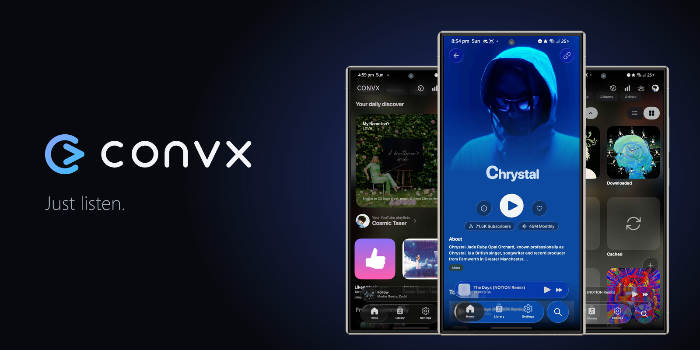
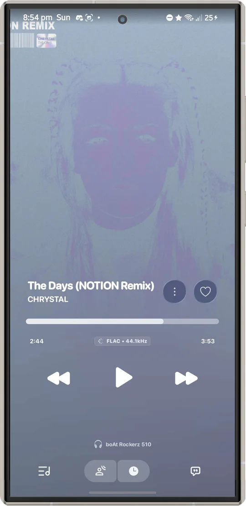
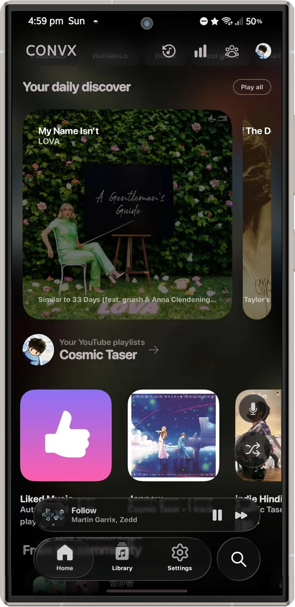
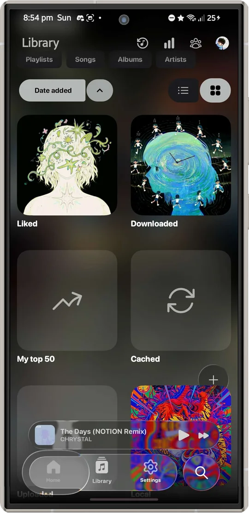
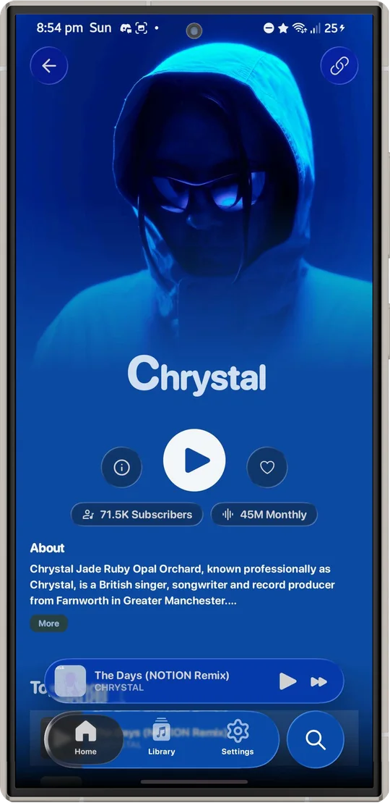
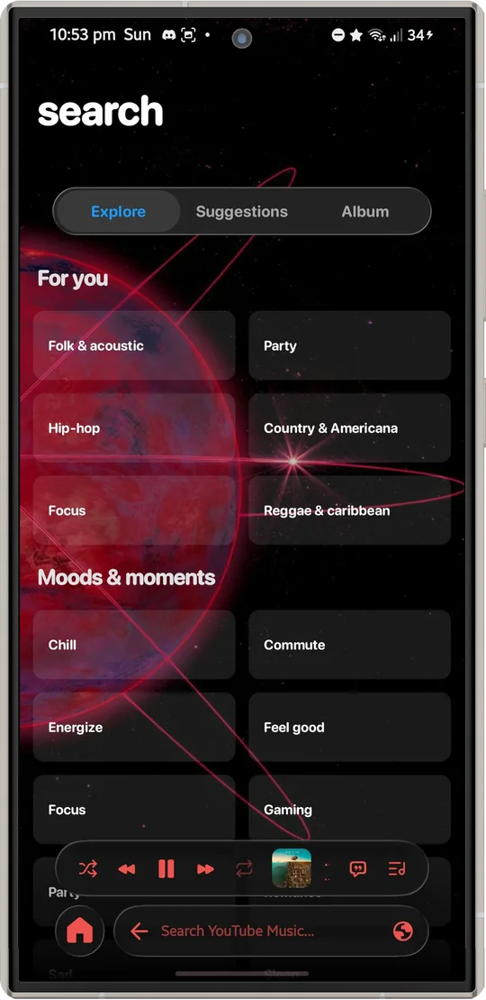

<div align="center">
  
  <h1>Convx</h1>
  <p><strong>An open-source Android music player with a calm, glass-inspired interface.</strong></p>
  <p>
    <a href="https://github.com/cosmictaserdev-creator/Convx/releases/tag/2.0.4-nightly">
      
    </a>
    <a href="https://github.com/cosmictaserdev-creator/Convx/releases/latest">
      
    </a>
  </p>
  <p>
    <a href="https://github.com/cosmictaserdev-creator/Convx/releases">
      
    </a>
  </p>
  <p>
    <a href="https://ko-fi.com/cosmictaser">
      
    </a>
    <a href="upi://pay?pa=cosmictaser%40okicici&pn=CosmicTaser&cu=INR">
      
    </a>
  </p>
  <p><strong>UPI ID:</strong> <code>cosmictaser@okicici</code><br><strong>UPI payment link:</strong> <code>upi://pay?pa=cosmictaser%40okicici&amp;pn=CosmicTaser&amp;cu=INR</code></p>
  <p>
    <a href="https://ngoni-sama.github.io/Convx/">Website</a> ·
    <a href=".github/CONTRIBUTING.md">Contributing</a> ·
    <a href="https://discord.gg/Ejeb4cmzfd">Community</a>
  </p>
  <p>
    
    
  </p>
</div>

> [!NOTE]
> This repository is a modified version of [Convx](https://github.com/cosmictaserdev-creator/Convx) by Aryan (Cosmic Taser), changed on 1 November 2026. It adds a new logo, a website and fixes for tempo and pitch, tablet lyrics and the search queue. See [NOTICE](NOTICE). The downloads below come from the original project and don't include these changes.

> [!WARNING]
> **The current Stable release is outdated and not working.** Use [Nightly 2.0.4](https://github.com/cosmictaserdev-creator/Convx/releases/tag/2.0.4-nightly) from GitHub while the remaining issues are fixed. A refreshed Stable release will be published soon after they are fixed.
>
> The project website is being reworked, so download from GitHub Releases for now.

Convx brings music discovery, playback, lyrics, and your library together in one Android app. It is built with Kotlin, Jetpack Compose, and Media3, with custom Cupertino-style controls and Liquid Glass surfaces.

## Features

### Playback

- Browse and stream music through Convx's InnerTube client.
- Keep listening in the background with notification, lock-screen, and Android Auto controls.
- Save music for offline listening and manage a local library.
- Build queues and playlists, set a sleep timer, change playback speed, and use the equalizer.
- Use crossfade, Automix, and DJ-style transitions.

### Lyrics and artwork

- Follow synchronized lyrics with word-level highlighting.
- Explore animated artwork and album-inspired colors.
- Browse lyrics from multiple providers.

### Library and integrations

- Browse local music and network shares, including SMB and WebDAV.
- Import playlists from Spotify.
- Connect Discord Rich Presence, Last.fm, music recognition, and Listen Together.

### Convx interface

- Frosted, refractive glass surfaces for menus, sheets, and floating controls.
- Cupertino-style controls built for Convx's HIG and Android interaction patterns.
- Adaptive themes and layouts for phones and wider screens.

## Screenshots

<table>
  <tr>
    <td align="center"><br>Now Playing</td>
    <td align="center"><br>Home</td>
    <td align="center"><br>Library</td>
    <td align="center"><br>Artist</td>
    <td align="center"><br>Explore</td>
  </tr>
</table>

## Download

- **Stable:** The current release is outdated and not working. A refreshed Stable release will be published soon after the remaining issues are fixed.
- **Nightly 2.0.4:** [Download from GitHub Releases](https://github.com/cosmictaserdev-creator/Convx/releases/tag/2.0.4-nightly). Nightlies are pre-release builds and may be unstable. On a 32-bit-only phone (for example Galaxy A13) that says "app not compatible", download the `arm32` APK from the same release.

The project website is being reworked. Use GitHub Releases for downloads for now.

Convx supports Android 8.0 (API 26) and later. Install APKs only from sources you trust. Android may ask you to allow installation from the app you used to download the APK.

## Project structure

Convx is a Gradle multi-module Android project. Keep code in the module that owns the capability, and use its existing public APIs when another module needs it.

| Path | Responsibility |
| --- | --- |
| `app/` | Android application, screens, ViewModels, navigation, playback service, persistence, and app wiring. |
| `hig/` | Shared Cupertino-style controls, theme primitives, accessibility helpers, and glass utilities. |
| `innertube/` | InnerTube client and related models. |
| `lyrics/` | Lyrics providers, parsing, and lyrics support. |
| `canvas/` | Animated canvas and catalog features. |
| `artwork/` | Artwork loading, caching, and transitions. |
| `spotify/` | Spotify authentication and playlist import. |
| `integrations/` | Discord, Last.fm, music recognition, and related integrations. |
| `network-storage/` | SMB and WebDAV music sources. |
| `spine/` | Add-on module hosting and lifecycle. |
| `listen-together-server/` | Server component for Listen Together. |

The Android app uses Jetpack Compose for UI, Media3 for playback, Room for the local library, and DataStore for preferences. App modules are wired through the existing Hilt setup.

## Build locally

### Requirements

- JDK 21
- Android Studio with Android SDK 37 installed
- Android NDK for native components

Clone the repository, open it in Android Studio, and let Gradle sync. To build a debug APK or run unit tests from a terminal:

```bash
./gradlew :app:assembleUniversalFossDebug
./gradlew :app:testUniversalFossDebugUnitTest
```

On Windows, use `gradlew.bat` with the same task names. The `Foss` build omits Google Play services; the `Gms` build includes Google Cast support.

## Contributing

Bug reports, fixes, and feature contributions are welcome. Start with the [Contributing Guide](.github/CONTRIBUTING.md), follow the [Code of Conduct](CODE_OF_CONDUCT.md), and read the [Security Policy](SECURITY.md) before reporting a vulnerability.

AI agents should also follow the [Agent Contribution Guide](AGENT_CONTRIBUTION_GUIDE.md). Its Android, animation, code review, and requirement discovery skills are bundled under [`contributor/skills/`](contributor/skills/) and work offline.

## Support

- [Discord community](https://discord.gg/Ejeb4cmzfd)
- [Support Convx on Ko-fi](https://ko-fi.com/cosmictaser)
- [Project website (being reworked)](https://cosmictaser.de5.net)

## Legal

Convx is an independent project and is not affiliated with, endorsed by, or connected to YouTube, Google, or their affiliates. Some features use unofficial third-party interfaces that may change or stop working. Users are responsible for following applicable laws and service terms.

Convx is licensed under the GNU General Public License v3.0. See [LICENSE](LICENSE) and [NOTICE](NOTICE) for license and third-party attribution details.

---

Maintained by [Ngoni-Sama](https://github.com/Ngoni-Sama). Based on [Convx](https://github.com/cosmictaserdev-creator/Convx) by [Aryan (Cosmic Taser)](https://github.com/cosmictaserdev-creator).
